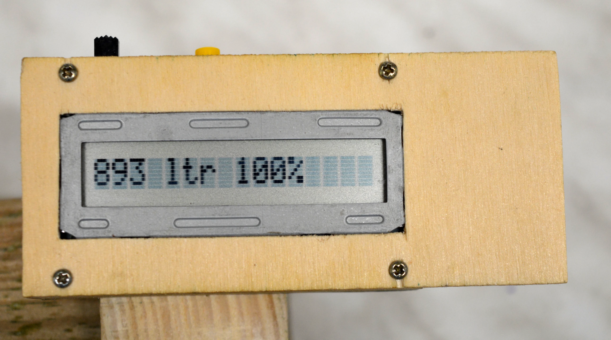
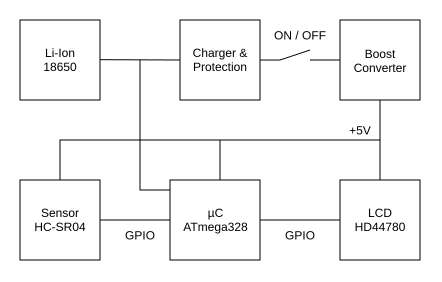

# Water Level Meter

Ultrasonic fill level sensor for underground cistern. Shows the amount of water in liters and the fill level in percent when placed above a small hole in the cistern's lid.

## Features

* 3 operating modes:
    * Show raw distance measurement
    * Show fill level in liters and percent
    * Show battery voltage
* Rechargeable battery

## Technology

## Reliability

Regular use since 2020 without issues.
